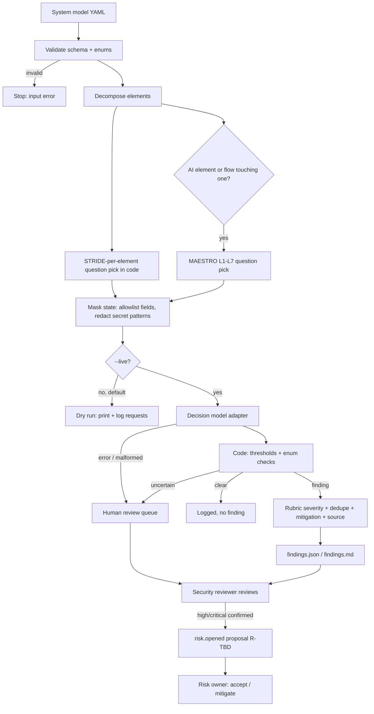

# Threat modeling with a decision model: STRIDE + MAESTRO workflow
Status: DRAFT example. Get risk-owner approval before you connect it to any gate.
Motto: **Repeatable, Defendable, Reusable.** Rule: **The decision model judges, code decides.**

## Inputs
- **System model YAML** (`system-model.schema.yaml`): components (`process`), `data_store`, `data_flow`
  (source/destination/protocol/crosses_boundary), `external_entity`, AI elements (`agent`, `tool`, `model`),
  `trust_boundaries`, plus per-element `exposure`, `data_classification`, declared `controls`, and
  `secret_refs` (**KEY NAMES only**). Example: `examples/example-fastapi-agent.yaml` (hypothetical).
- **Question sets**: `questions/stride.yaml`, `questions/maestro.yaml`. All wording lives there, versioned.

## Steps
1. **Decompose**: author or update the system model (app owner drafts, security reviewer reviews). Runner validates enums/ids, fails on bad input.
2. **STRIDE per element**: code picks which questions apply using Microsoft STRIDE-per-element
   (external entity: S,R · process/agent/tool: all six · data store: T,R,I,D,E · flow: S,T,I,D). The decision model never picks.
3. **MAESTRO per layer**: only for AI elements (agent/tool/model) and flows touching them. L1 Foundation Models,
   L2 Data Operations, L3 Agent Frameworks, L4 Deployment & Infrastructure, L5 Evaluation & Observability,
   L6 Security & Compliance (vertical), L7 Agent Ecosystem.
4. **Masked request, one per element**: only allowlisted fields; secret-shaped text replaced with `[REDACTED:<pattern>]`;
   unknown fields dropped; IDs swapped for names. All questions for an element are bundled (shared state).
5. **Decision model answers** typed judgments: yes/no/unsure (observable fact, e.g. "Is the flow plain HTTP?"), pick-one (e.g. autonomy level), or score 0-1.
6. **Code decides**:
   - Yes/no: p ≥ 0.70 = yes, ≤ 0.30 = no, between = **human review**.
   - Pick-one/score: answer must be in the allowed enum and confidence ≥ 0.60, else **human review**.
   - Error, timeout, malformed/NaN/bool/out-of-range answer = **human review** (fail closed, never "clear").
   - Severity from a fixed rubric in code: impact (public 1, internal 2, pii 3, credentials 4) × exposure
     (host_only 1, lan 2, internet 3), +2 if an autonomous agent drives it. ≤2 low, ≤5 medium, ≤8 high, else critical. Enum-checked.
   - Dedupe on (element, mitigation id); review status wins over finding.
7. **Findings + mitigations**: `findings.json` / `findings.md`. Each finding has element/flow, STRIDE category or MAESTRO layer,
   exact mitigation (catalog id + text), public source, the decision model answer, confidence, input hash, model.
8. **Human review queue**: every `needs_human_review` item goes to the security reviewer. The reviewer confirms, dismisses (with reason), or edits.
9. **Risk register proposal**: high/critical confirmed findings become `risk.opened` event proposals (`risk_proposals.jsonl`,
   `risk_id: R-TBD`). The reviewer assigns a register ID and adds it to the register; **only the risk owner** approves `risk.accepted`. Corrections use `supersedes`.

## Roles
| Role | Who | Does |
|---|---|---|
| Model author | app owner | Writes system model YAML |
| Runner | Approved operator on an approved host | Dry run, then live run with `DECISION_MODEL_API_KEY` |
| Judge | Decision model | Advisory typed answers only |
| Reviewer / sign-off | Security reviewer (human) | Works review queue, signs `review.signed_off`, proposes register entries |
| Risk acceptance | Risk owner only (direct, not relayed) | Approves `risk.accepted` and any gate wiring |

## Audit (every question, every run)
`audit.jsonl`: ts (UTC), run_id, element, question_id, framework, `input_sha256` (canonical request JSON), model id returned,
answer, confidence, decision, reason, redaction pattern names (never values). `requests.jsonl` keeps the exact masked payloads for replay.

## Flow

## v2.1 scoring (after calibration; see CALIBRATION-LESSON.md)

**Question kinds.** the decision model answers narrow facts; code decides the outcome.
- `control` (choice present / absent_stated / not_mentioned): present → clear; absent_stated → `confirmed_finding`; not_mentioned → `documentation_gap` (info, never a risk proposal).
- `weakness` (yes/no): yes → `confirmed_finding`; no → clear.
- `context`: a code rule decides.
- `code_fact`: the model already says it (protocol, autonomy), so the decision model is not asked.
- Uncertain, low-confidence, invalid or error → `needs_human_review` (fail closed).
- Replay with no mappable answer → `not_asked` (review queue).

**Code rules.**
- R-PII-FLOW: PII on a data_flow is a `confirmed_finding` only if transport is absent_stated (plain HTTP/TCP), OR the destination is a model or external entity, OR it goes to a less-trusted zone (host > container > lan > third_party > internet). Otherwise it is `informational`.
- R-AUTONOMY: an `acts_autonomously` agent *with tools* is confirmed. Otherwise it is informational.
- Applicability: `D.rate_limiting` applies to processes only; `S.authn_present` to processes, tools, and data_flows; PII questions to data_flows.
- R-FLOW-AUTHN (v2.1): `S.authn_present` is asked on a data_flow only when `crosses_boundary: true`. A stated absence of authentication → `confirmed_finding`; not mentioned → `documentation_gap`.
- R-OUTPUT-SINK (v2.1): the output-handling cap is raised to high when model output reaches a dangerous sink, judged from existing attributes. That means the agent has `tools` (output becomes tool args), or a data_flow from the agent or its model goes to a tool, process or data_store (rendered in a UI, executed, or used in queries). Otherwise the cap is medium. No new the decision model question.

**Severity = min(rubric, family cap).**
- Rubric: impact (public 1, internal 2, pii 3, credentials 4) × exposure (host 1, lan 2, internet 3), +2 if an autonomous agent drives the element.
- Bands: ≤2 low, ≤5 medium, ≤8 high, >8 critical.
- Gaps and informational items are `info`. The enum is checked in code.

| Family (mitigations) | Cap | Rationale | Source |
|---|---|---|---|
| logging (M-AUDIT, M-AGENT-TRACE) | medium (confirmed in v2.1) | Detective control; its absence does not itself expose data | OWASP Logging Cheat Sheet; OWASP Top 10 A09:2021 |
| dos (M-RATELIMIT) | medium; high only if internet AND authn absent_stated | Availability impact; unauthenticated internet entry points are the realistic abuse case | OWASP API4:2023 Unrestricted Resource Consumption |
| authz (M-AUTHZ, M-DELEGATED-AUTHZ, M-LEASTPRIV, M-TOOL-VALIDATE) | high if pii/credentials, else medium | BOLA on personal data is the top API risk | OWASP API1:2023 BOLA; LLM06:2025 Excessive Agency |
| data_exposure, M-TLS | high if pii/credentials AND crosses a boundary or goes to a less-trusted zone, else medium | Cleartext PII across a boundary is directly observable | OWASP A02:2021; OWASP TLS Cheat Sheet |
| data_exposure, M-MINIMIZE / M-PII-REDACT | high only if pii AND plaintext transport, else medium | Minimization is defence-in-depth unless the channel is also open | OWASP LLM02:2025 Sensitive Information Disclosure |
| prompt_injection (M-PI-ISOLATE, M-CODE-GUARD, M-HITL) | high if the agent has tools and can act; else medium | Injection becomes impact through side-effecting tools | OWASP LLM01:2025, LLM06:2025; CSA MAESTRO L3 |
| model_endpoint (M-ENDPOINT-LOCK) | high if lan/internet AND pii, else medium | An exposed gateway leaks prompts and data and burns compute | CSA MAESTRO L4 |
| authn (M-AUTHN, M-IDV) | high; critical only if internet + credentials | Missing authn on credential-bearing internet components is account takeover | Microsoft STRIDE-per-element; OWASP API2:2023 |
| input_validation (M-VALIDATE, M-PARAMQ) | high | Injection class | OWASP Input Validation Cheat Sheet |
| output_handling (M-OUTPUT-ENCODE) | medium; high if R-OUTPUT-SINK | Impact depends on the sink: XSS, injection or tool misuse happen only when output is rendered or executed | OWASP LLM05:2025 Improper Output Handling |
| supply_chain, at_rest, ecosystem | medium | Hardening | OWASP LLM03:2025; Cryptographic Storage Cheat Sheet |

**Risk proposals.**
- Only `confirmed_finding` at high or critical becomes a proposal.
- Proposals are deduped per (element, family) root cause.
- They stay proposals: The reviewer assigns a register ID, and the risk owner approves.

**Replay.** `--replay <audit.jsonl>` re-scores recorded answers with no network.
- Questions are mapped through `replay_from`.
- A v1 control "no" becomes `documentation_gap` (it can't be split). Re-run live to split it.
- The audit keeps the v1 hash and model alongside the v2 hash.

## Sources
- STRIDE definitions & per-element: https://learn.microsoft.com/en-us/azure/security/develop/threat-modeling-tool-threats
- OWASP Threat Modeling Process: https://owasp.org/www-community/Threat_Modeling_Process
- MAESTRO (CSA, Ken Huang): https://cloudsecurityalliance.org/blog/2025/02/06/agentic-ai-threat-modeling-framework-maestro
- MAESTRO layers playbook: https://agentic-threat-modeling.github.io/MAESTRO/playbook/01-layers.html
- OWASP Top 10 for LLM Apps 2025: https://genai.owasp.org/llm-top-10/
